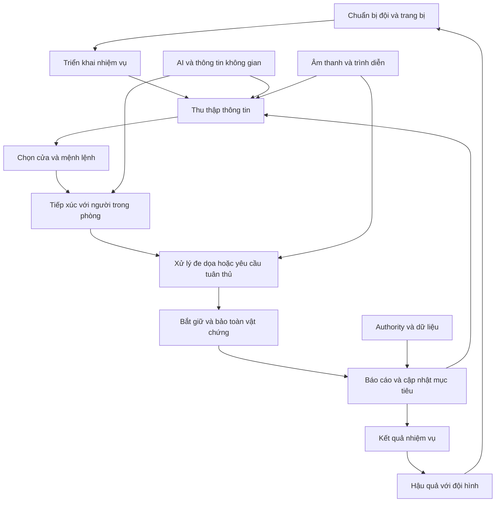

# Tổng kết hệ thống và cách học Ready or Not

Nguồn của chương: **TDD §0, trang 3–4**, đọc cùng §1, trang 5–7 và §18, trang 114–116. Các nhận định về source dưới đây thuộc snapshot được PDF mô tả. Phần hướng học là cách tổ chức bài tập trong bộ sách này.

## Game yêu cầu người chơi giải quyết điều gì

Bạn bước vào một tòa nhà nhưng không biết đầy đủ ai ở đâu, người đó có nguy hiểm hay không và lối đi nào an toàn. Hành động nhanh có thể giải quyết một mối đe dọa, nhưng cũng có thể khiến dân thường chết, đội viên bị thương hoặc vi phạm quy tắc sử dụng vũ lực. Sau mỗi hành động, bạn cần cập nhật hiểu biết của mình về căn phòng và hoàn thành quy trình xử lý hiện trường.

Vì vậy, hệ thống súng phục vụ một vòng quyết định rộng hơn. Âm thanh cung cấp thông tin qua các cửa; cửa cho phép quan sát và chọn cách vào; AI diễn đạt mối đe dọa và khả năng tuân thủ; mệnh lệnh giúp chia công việc; ROE và chấm điểm làm cho cách xử lý có hậu quả. Commander nối hậu quả của một nhiệm vụ sang nhiệm vụ kế tiếp. Nếu tách bỏ hết các quan hệ này, chỉ giữ súng và hình ảnh, bạn chưa tái tạo được trải nghiệm mà TDD mô tả.

## Mười ý chính của TDD được diễn giải lại

| Ý chính | Ý nghĩa kỹ thuật | Điều người học cần phân biệt |
|---|---|---|
| Nhịp chơi có luật cưỡng chế | Snapshot trong TDD có define tắt sprint, jump và speed dial; action có thể bị từ chối khi trạng thái không cho phép | Không suy từ class hay input còn tồn tại rằng tính năng đang được bật |
| Người AI có nhiều tầng quyết định | Perception, bộ đệm phản ứng, thông tin đã biết, utility và activity phối hợp | Nhìn thấy ngay không đồng nghĩa được phép phản ứng ngay |
| Cover dựa trên dữ liệu không gian | Điểm cover được bake từ navmesh; lựa chọn chạy qua các phép đánh giá | Bake thành công không chứng minh điểm còn hợp lệ sau khi sửa hình học |
| Level có nhiều lớp nội dung | Sublevel theo chuyên môn và mode, roster và label biến thiên lượt chơi | Ngẫu nhiên không có nghĩa bố trí tùy tiện mà không có quy tắc |
| Âm thanh mang thông tin không gian | Room/portal graph mô tả đường đi qua các chỗ mở | Khoảng cách Euclid không đủ mô tả tiếng vọng qua nhiều phòng |
| Quy trình được chấm điểm | Bắt giữ, báo cáo, vật chứng, vi phạm và mục tiêu đi vào kết quả | Neutralize hết nghi phạm không tự đồng nghĩa hoàn thành tốt nhiệm vụ |
| Commander giữ hậu quả lâu dài | Roster, stress, therapy và mất đội viên | Giá trị khởi tạo C++ có thể khác config mà TDD khảo sát |
| Networking có các ranh giới tin cậy | Server quyết định các trạng thái quan trọng; TDD nêu những RPC còn thiếu validation | Có tên `Server_` không tự bảo đảm dữ liệu nhận vào hợp lệ |
| Pipeline là một phần sản phẩm | Công cụ bake, content pipeline, build và debug giúp làm nhiều nhiệm vụ | Tạo một map bằng tay khác với có quy trình tạo map lặp lại được |
| Lỗi lặp theo mẫu | Build flavor, integer division, vòng lặp, validation và biến không được sử dụng | Học nguyên nhân và viết ca hồi quy, không sao chép lỗi để gọi là giống gốc |

TDD ghi phạm vi khoảng 1.507 file dưới `Source/`, khoảng 348 nghìn dòng và 536 file source plugin; khoảng 135 nghìn asset, 36 thư mục map `RoN_*`, 3.036 FMOD event và khoảng 130 AI archetype. Các số này mô tả phạm vi kiểm kê của PDF, không phải mục tiêu cần đạt trước khi làm được một game nhỏ. Chúng cũng không bằng số màn chơi, số hành vi AI hay số âm thanh độc lập người chơi nghe được.

Trong bộ Docs hiện có, catalog ngày 08/10/2026 ghi phạm vi khác, gồm cả các thay đổi của lab. Không lấy chênh lệch số file để suy rằng game đã có thêm hay bớt một tính năng. [Hồ sơ đối chiếu](21-nguon-va-doi-chieu.md) giữ hai nguồn tách biệt.

## Bản đồ quan hệ cần hiểu trước class

Sơ đồ trên là cách trình bày lại quan hệ phục vụ học tập, không phải sơ đồ class nguyên bản. Hãy dùng nó để đặt câu hỏi trước khi mở code: hệ thống mình đang viết nhận quyết định từ đâu và kết quả của nó sẽ được hệ thống nào dùng tiếp?

## Ba loại state không nên trộn

**Sự thật gameplay** là những điều làm thay đổi kết quả: đạn còn bao nhiêu, cửa bị khóa không, người đã bị còng chưa, mục tiêu đã hoàn thành chưa. **Thông tin AI được phép biết** có thể là bản ghi cũ hoặc chưa đủ; AI không nhất thiết được đọc trực tiếp mọi sự thật. **Trình diễn** là cách người chơi nhận biết state: animation, âm thanh, widget, camera và VFX.

Một nghi phạm có thể đã nghe một tiếng động nhưng chưa xác định được người chơi. Trong khoảng đó, game có thể trình diễn việc quay đầu hoặc nói một câu. Nếu bạn cho controller đọc ngay vị trí thật của người chơi, bạn đã bỏ qua tầng thông tin. Nếu animation giơ tay chạy nhưng actor vẫn ở state chiến đấu, bạn đã làm trình diễn mâu thuẫn với gameplay. Những lỗi này không sửa được chỉ bằng thêm asset đẹp.

## Cách biến mô tả thành yêu cầu có thể viết

Với mỗi động từ, ghi một hợp đồng gồm tám câu hỏi:

1. Ai yêu cầu hành động, bằng input hoặc sự kiện nào?
2. Điều kiện nào cho phép hoặc từ chối?
3. Actor/component nào sở hữu state?
4. Dữ liệu nào điều chỉnh hành vi?
5. Mốc nào chốt kết quả, và có thể hủy trước/sau mốc đó không?
6. AI, client khác và UI nhận kết quả bằng cách nào?
7. Người chơi thấy và nghe điều gì?
8. Reset hoặc replay phải dọn những gì?

Ví dụ với “thu vật chứng”, sản phẩm tối thiểu không chỉ là item biến mất. Hai input thu liên tiếp không được tăng điểm hai lần; người quan sát khác phải thấy item đã được thu; hủy hành động không được khiến state bị kẹt; chơi lại nhiệm vụ phải sinh đúng vật chứng mới. Đây là tiêu chí đề xuất cho bài tập, không phải xác nhận code gốc đã qua tất cả các ca ấy.

## Hiểu toàn bộ và triển khai toàn bộ là hai chặng

Để **hiểu có hệ thống**, bạn cần bản đồ trách nhiệm, dữ liệu và phụ thuộc của các nhóm trong 19 mục. Để **tự tái tạo**, mỗi nhóm còn cần implementation, tài nguyên phù hợp, tích hợp, phép thử và tinh chỉnh trải nghiệm. TDD là đầu vào cho quá trình đó, không phải mã nguồn chạy được hoặc danh sách asset đã đủ.

Hãy bắt đầu với một mission hai phòng. Khi nó có thể triển khai, quan sát, xử lý, báo cáo, chấm điểm và chơi lại, bạn đã có một cấu trúc đủ nhỏ để giải thích mà vẫn chứa bản chất vòng chơi. Sau đó thay từng fixture bằng hệ thống sâu hơn: AI thật, đội SWAT, nhiều loại cửa, âm thanh theo phòng, nhiều người chơi và meta-game. [Lộ trình chương 19](19-lo-trinh-tai-tao.md) xác định từng đầu ra cụ thể.
