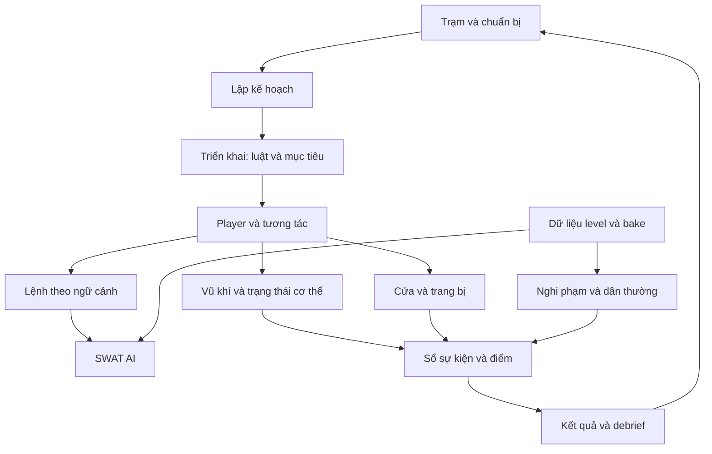

# 01 — Tổng quan: nhịp chơi, thông tin và vòng nhiệm vụ

Chương này diễn giải để học phát triển game từ **§1 của bản R&D reverse-engineered độc lập ngày 27/09/2026, trang in 5–7**. Đây không phải TDD chính thức của VOID Interactive. Các mô tả về Ready or Not bên dưới thuộc snapshot được PDF khảo sát; chúng không xác nhận hành vi của bản retail mới nhất hoặc source hiện tại. Mọi `file:line` ghi là **định vị do TDD ghi**, chưa được chương này kiểm tra độc lập. Phần bài tập là đề xuất tái tạo từ đầu, không phải mô tả thêm về game gốc.

## 1.1. Sản phẩm đang tối ưu điều gì? — PDF §1, tr. 5

Ready or Not được tài liệu mô tả là game bắn súng cảnh sát chiến thuật trong không gian gần, chơi một người cùng đồng đội AI hoặc co-op. Một đội SWAT xử lý sự cố trong công trình dày đặc: nghi phạm cố thủ, giải cứu con tin, đột kích, active shooter hoặc đe dọa bom. Điều quyết định thiết kế là **sống sót và hạ hết đối phương chưa đủ để thành công**. Vũ lực thiếu căn cứ, thương vong dân thường, chứng cứ bỏ sót và báo cáo thiếu đều có thể làm kết quả xấu đi.

Với người mới, hãy phân biệt “động tác” và “điều game thưởng”. Bắn là một động tác; giải quyết tình huống đúng quy trình là mục tiêu mà nhiều hệ thống cùng đánh giá. Nếu chỉ tái tạo súng, đạn và AI truy đuổi, ta có thể có một FPS hoạt động nhưng chưa có vòng chơi được PDF mô tả.

TDD tái dựng sáu trụ cột từ những hệ thống được đầu tư kỹ thuật. Đây là kết luận phân tích của tác giả, không phải tuyên bố thiết kế chính thức:

| Trụ cột | Cơ chế khiến người chơi cảm nhận được | Bài học cho người làm game |
|---|---|---|
| Nhịp hành động có cân nhắc | Snapshot không bật sprint, jump hoặc núm điều chỉnh tốc độ; nhiều hành động bị chặn bởi animation | Nhịp chậm cần được tạo bằng luật, thời gian và điều kiện chuyển trạng thái |
| Thông tin có giới hạn và gắn với thế giới | Gương dưới cửa, âm thanh qua portal, cửa mở hé, HUD ít thông tin | Cho người chơi công cụ thu thập thông tin, đồng thời giữ chi phí và điểm mù |
| Con người khó đoán | Utility AI, thời gian phản ứng, đầu hàng thật/giả, trốn và bỏ chạy; quần thể thay đổi mỗi lượt | Phản ứng cần phụ thuộc hoàn cảnh và dữ liệu, không chỉ một nhánh “thấy thì bắn” |
| Quy trình được chấm điểm | Rules of engagement, báo cáo, chứng cứ, bắt giữ đi vào điểm chữ | Điểm phải quan sát các hành vi mà thiết kế muốn khuyến khích |
| Chỉ huy đội | Lệnh theo ngữ cảnh; Gold, Red và Blue | Người chơi có thể tác động bằng phân công, không phải tự làm mọi việc |
| Hậu quả kéo dài | Commander lưu roster; stress, thương tật và mất sĩ quan | Kết quả nhiệm vụ tác động quyết định ở nhiệm vụ tiếp theo |

**Định vị do TDD ghi:** `ReadyOrNot.h:290-292` cho `RON_NO_JUMP`, `RON_NO_SPRINT`, `RON_NO_INCREMENTAL_SPEED`. Tên hàm hoặc code còn tồn tại không đủ chứng minh tính năng đang bật; [chương player](03-player-movement-interaction.md) giải thích cụ thể điểm này.

## 1.2. Bản đồ trách nhiệm hệ thống — PDF §1, tr. 5–6

Có thể học kiến trúc theo ba tầng. Tầng meta giữ trạm, loadout, tiến trình và roster. Tầng nhiệm vụ quản lý luật, mục tiêu, điểm và kết thúc. Trong nhiệm vụ, player, vũ khí, damage, trang bị và cửa tạo ra hành động cụ thể. Lệnh đội nối người chơi với SWAT AI; AI lại phụ thuộc dữ liệu level và dữ liệu đã bake. Audio, presentation và networking phục vụ nhiều tầng cùng lúc.

Sơ đồ trên là cách tổ chức kiến thức của chương, không cam kết thứ tự callback trong source. Ví dụ “bắt giữ” vừa cần tương tác của player, trạng thái đầu hàng của AI, animation và cập nhật mục tiêu. Vì vậy khi debug một feature, nên tìm chủ sở hữu trạng thái và các phụ thuộc trước khi tìm một hàm có tên giống feature.

PDF thống kê cây khảo sát có khoảng 1.507 file trong `Source/`, 10,9 MB và khoảng 348 nghìn dòng; plugin dự án có 536 file source, 5,0 MB; 36 thư mục map `RoN_*`, khoảng 135 nghìn `.uasset`, 1.343 `.umap`, 3.036 FMOD event và khoảng 130 AI archetype. Đây là các số đo của snapshot, không phải yêu cầu tối thiểu để làm game tương tự. §2 dùng phạm vi thống kê khác khi chỉ đếm `.h/.cpp` trong module, nên không nên gộp các con số thành một phép so sánh trực tiếp.

Stack được PDF ghi nhận là UE5.3 C++ cùng Blueprint, FMOD Studio 2.00.08; Steam qua AdvancedSessions; Vivox chỉ bật cho PlayStation; mod.io bị compile out. Tài liệu có dấu vết PC, PS4/PS5 và Xbox One/Series, cùng Perforce, UnrealGameSync, TeamCity, Jenkins và BuildGraph. Việc có đường code/nền tảng trong cây khảo sát không tự chứng minh một cấu hình phát hành hiện hành.

**Định vị do TDD ghi:** dấu `##UE5.3UPGRADE##` tại `Actors/BaseMagazineWeapon.cpp:2117`, `Actors/Attachments/WeaponAttachment.cpp:34`; binary editor `Binaries/Win64/UnrealEditor-ReadyOrNot.dll`. Một số plugin, ví dụ Motivity, vẫn khai báo 4.27 trong `.uplugin`: metadata cũ và engine đang dùng có thể không đồng nhất.

## 1.3. Vòng phiên chơi: chuẩn bị → nhiệm vụ → hậu quả — PDF §1, tr. 6

Vòng ngoài bắt đầu ở station hub: bàn chọn nhiệm vụ, cổng loadout/customization và trường bắn. Đây là nơi các quyết định chưa có áp lực thời gian có thể được thực hiện. Sau đó là planning sublevel được stream, có sơ đồ tầng để đội chọn điểm vào, nhân sự và trang bị triển khai.

Hai mặc định đáng giữ đúng là `PlanningTimeLeft = 480 s` và `BaseSquadPts = 10` trong dữ liệu level. “Mặc định” không có nghĩa mọi nhiệm vụ luôn dùng giá trị đó: asset hoặc cấu hình có thể thay đổi nội dung cuối cùng. Khi triển khai một hệ thống học tập, hãy lưu riêng giá trị mặc định, giá trị override và giá trị đang chạy để dễ quan sát.

| Bước | Trạng thái cần hình dung | Hệ thống chính |
|---|---|---|
| Trạm | Đang chọn nhiệm vụ và trang bị | Hub, loadout, customization |
| Planning | Có bản đồ, thời gian và ngân sách lựa chọn | Mission plan, dữ liệu level |
| Deploy | Reset phiên, spawn lại, lấy mẫu roster | GameMode và hệ thống level |
| Play | Mục tiêu còn mở; người và đồ vật tiếp tục đổi trạng thái | Player, AI, doors, scoring |
| End | Đã xác định thắng/thua; tổng hợp điểm và hậu quả | GameMode, debrief, Commander |

Theo TDD, `ACoopGM::StartMatch` reset level, respawn player/cảnh sát, chọn roster AI, bẫy và layout, rồi bắt đầu kiểm tra điều kiện thắng theo nhịp. Điều này cho thấy ngẫu nhiên của nhiệm vụ có điểm khởi tạo rõ ràng. Không nên để mỗi client tự chọn nghi phạm hoặc bẫy của mình.

**Định vị do TDD ghi:** `Actors/Environment/MissionSelect`, `Actors/Triggers/*Portal`; `ReadyOrNotGameState.h:505`; `GameModes/CoopGM.cpp:134-157`; `ReadyOrNotGameMode.cpp:150-210`. Các mẫu đường dẫn không có dòng cụ thể chỉ là vị trí thư mục/file mà PDF nêu.

## 1.4. Vòng căn phòng: hành động nhỏ tạo kết quả lớn — PDF §1, tr. 6

Vòng gần gồm: tiếp cận → thu thập thông tin → quyết định cách xử lý cửa → vào và kiểm soát → yêu cầu tuân thủ → khống chế/thu chứng cứ → báo TOC → phòng tiếp theo. Đây là chuỗi học thiết kế, không phải đường ray bắt người chơi luôn thực hiện đủ từng bước.

Trước một cửa, người chơi có thể nghe, dùng gương hoặc mở hé. Kiểm tra khóa mở ra các lựa chọn như mở khóa, ram, kick, C2, shotgun hoặc wedge. Các lựa chọn trao đổi thời gian, tiếng động, mức độ an toàn và khả năng tiếp cận; chương này không tự gán thêm giá trị cân bằng mà nguồn chưa nêu.

Sau khi vào phòng, flash/sting và chia đội tạo điều kiện cho kiểm soát. Yell không đồng nghĩa AI lập tức đầu hàng: AI có thời gian phản ứng và có thể đầu hàng, giả vờ, bỏ chạy hoặc chiến đấu. Khi nguy cơ tức thời giảm, vòng chơi vẫn chưa xong. Zip-cuff, thu vũ khí, thu chứng cứ và báo TOC chuyển một tình huống “đã tạm an toàn” thành một phần nhiệm vụ được xác nhận.

Để tái tạo đúng ý tưởng, hãy ghi nhận các sự kiện riêng: đối tượng mất khả năng chiến đấu, đối tượng bị bắt, vật chứng được thu, báo cáo được chấp nhận. Gộp chúng thành một cờ `RoomCleared` sẽ làm mất khả năng chấm quy trình và khó giải thích vì sao người chơi bị trừ điểm. TDD nối chuỗi này với §7 về cửa, §3/§5 về yell và arrest, §9 về phản ứng AI, §10 về điểm và §11/§13 về TOC/audio.

## 1.5. Dữ liệu, authority và cách mở rộng — PDF §1, tr. 6–7

TDD nhấn mạnh sự phân công: C++ cung cấp cơ chế; Blueprint, DataTable và cấu hình cung cấp nội dung. Level dùng `FLevelDataLookupTable`; AI có archetype, preset và INI; item/ammo có dữ liệu riêng; điểm dùng DataTable; âm thanh dùng FMOD parameter/snapshot; hiệu ứng hình ảnh dùng dữ liệu post-process. Bài học là designer nên sửa “ai xuất hiện, dùng tham số nào” mà không phải sửa vòng lặp gameplay mỗi lần.

Trong mô hình mạng được PDF mô tả, co-op có listen server hoặc dedicated server; còn có các mode PvP. Server sở hữu AI, điểm, roster và trạng thái cửa. Client dự đoán chuyển động và phản hồi vũ khí của chính mình; tính lan truyền âm thanh tại máy. Phản hồi tức thời không đồng nghĩa client được quyền quyết định kết quả cuối cùng.

| Muốn thêm | Điểm mở rộng được PDF nêu | Cần hiểu trước |
|---|---|---|
| Nhiệm vụ | Dữ liệu và tập sublevel | Khởi tạo roster, mục tiêu và reset |
| Hành vi AI | Archetype data | Cơ chế quyết định có hỗ trợ hành vi đó hay chưa |
| Trang bị | Item class và item data | Inventory, action gate, authority |
| Chế độ chơi | Subclass GameMode/GameState | Trạng thái server và trạng thái client cần quan sát |
| Mod level | `UModLevelData` | Có đường dữ liệu không có nghĩa dịch vụ mod.io đang bật |

§1 chỉ dẫn sang §17 cho danh sách rủi ro tổng hợp; không đưa danh sách lỗi riêng để suy rộng. Giá trị có thể tái sử dụng ở §1 là nhịp qua movement/animation gate, thông tin vật lý, utility AI có độ trễ, roster dựa dữ liệu và điểm thưởng quy trình. Nên chọn một lát cắt nhỏ của các ý tưởng đó trước khi đầu tư vào quy mô nội dung như snapshot.

## Bài thực hành tái tạo — một phòng, một cửa, một quy trình

**Đây là bài tập do chương đề xuất.** Tạo một nhiệm vụ gồm hai người chơi thử nghiệm hoặc một player và đồng đội AI tối giản, một cửa, một nghi phạm, một vật chứng và điểm báo cáo. Dùng asset tự tạo; không cần code hoặc nội dung gốc.

| Phần hợp đồng | Yêu cầu cho bài tập |
|---|---|
| Owner | Server giữ trạng thái nhiệm vụ, cửa, nghi phạm, vật chứng và sổ điểm; client giữ prompt, camera và phản hồi input |
| State | Nhiệm vụ `Planning → Active → Debrief`; nghi phạm `Alert → Complying/Resisting → Restrained`; vật chứng `Present → Collected` |
| Dependencies | Interactable, một action gate animation, dữ liệu roster, bảng điểm, log sự kiện và reset |
| Acceptance | Chơi lại reset đủ state; hai client thấy cùng roster/cửa; báo cáo lặp không cộng điểm; hạ nghi phạm chưa tự hoàn thành thu chứng cứ; debrief giải thích được từng điểm |

Đầu tiên dùng roster cố định để kiểm tra vòng hoàn chỉnh. Sau đó thay roster bằng dữ liệu có seed và so sánh hai lần chạy. Cuối cùng đo thời gian từ tiếp cận cửa đến báo cáo: nếu người chơi chỉ lao vào bắn, kiểm tra xem thu thập thông tin và quy trình có tạo quyết định hữu ích chưa.

Đọc tiếp [vòng nhiệm vụ](../02-Gameplay-Va-AI/01-Vong-Nhiem-Vu.md), [mục tiêu, ROE và điểm](../02-Gameplay-Va-AI/02-Muc-Tieu-ROE-Diem.md), [tương tác, bắt giữ và vật chứng](../02-Gameplay-Va-AI/03-Tuong-Tac-Bat-Giu-Vat-Chung.md), [hợp đồng feature](../01-Ban-Do-Kien-Thuc/03-hop-dong-feature.md), rồi sang [kiến trúc codebase](02-kien-truc-codebase.md).
